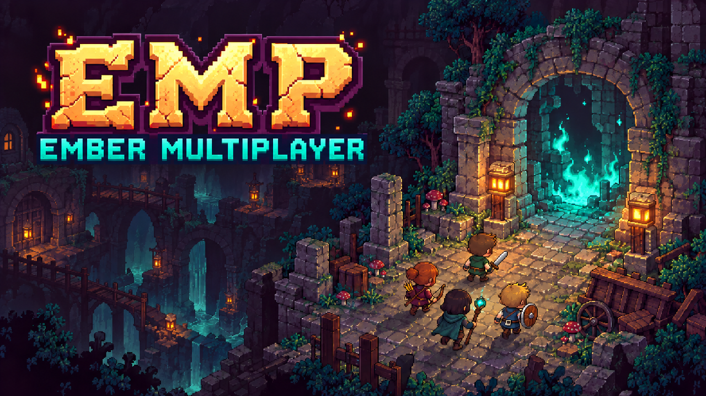
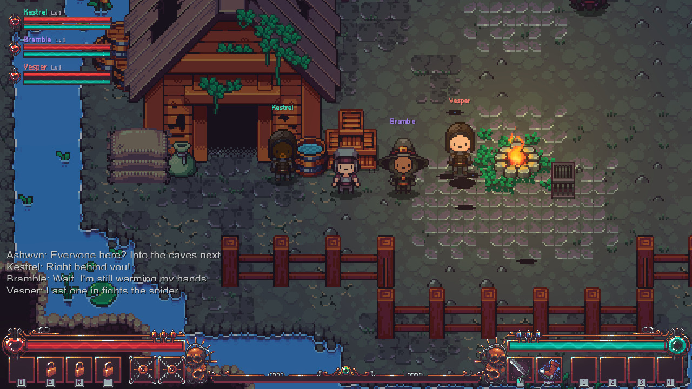
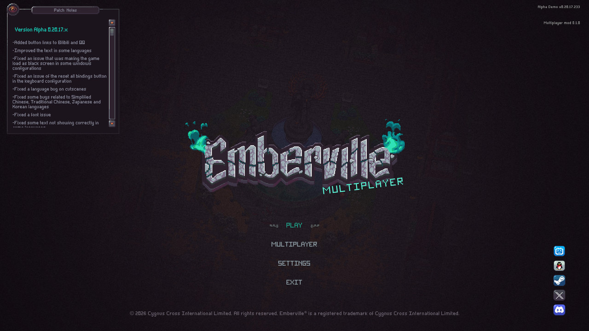
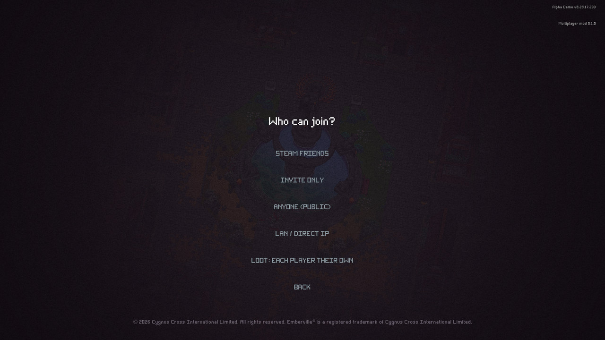
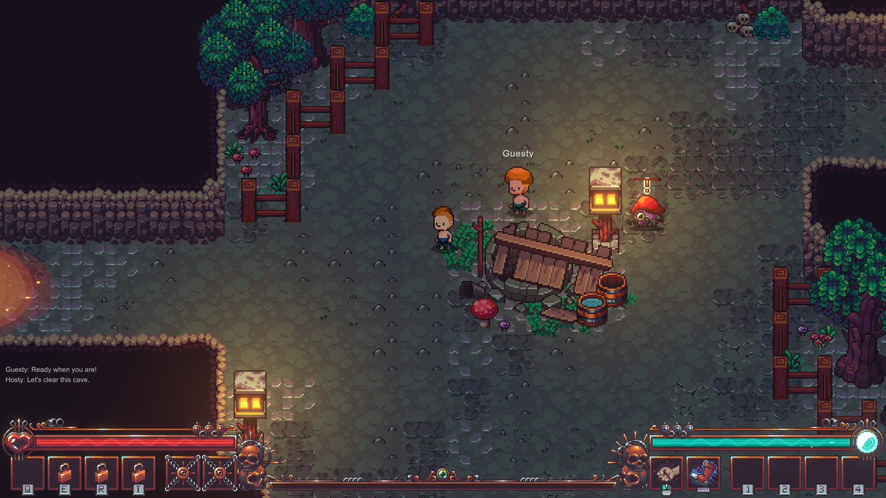
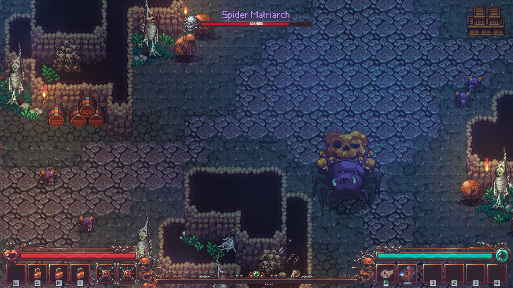
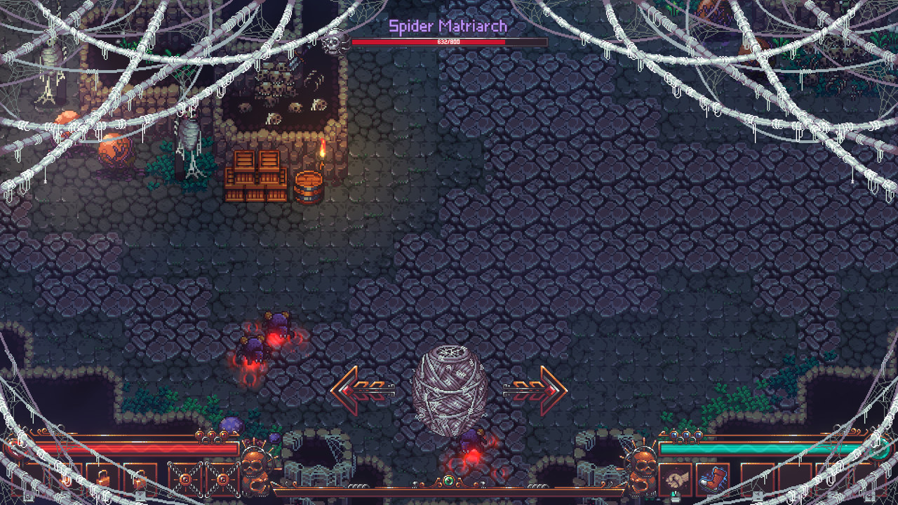
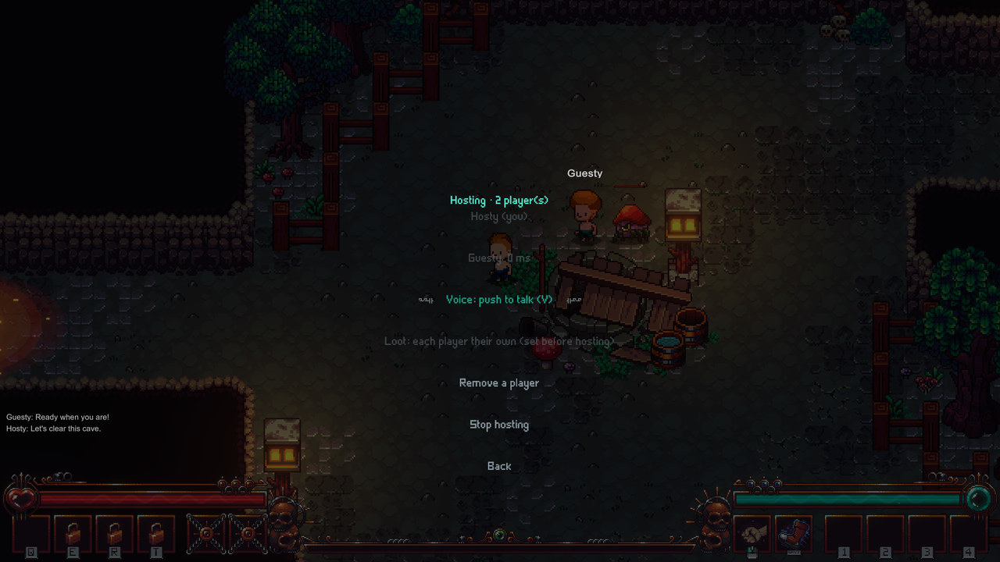
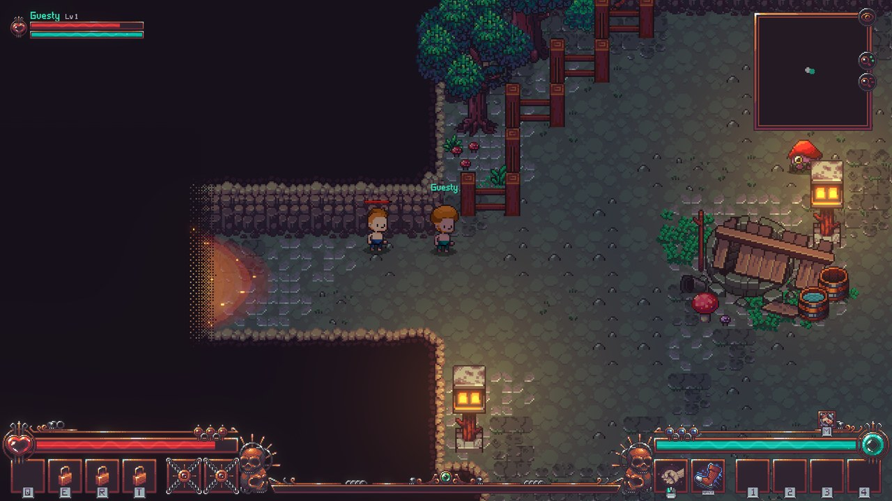
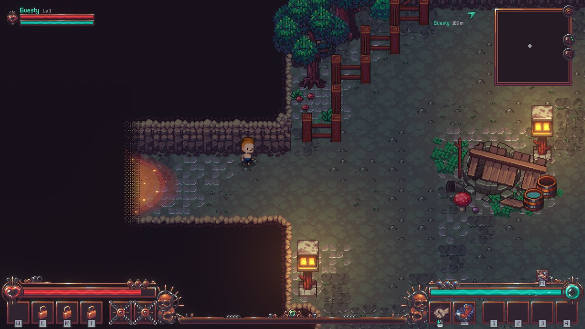

## EMP: Ember Multiplayer

### Online co-op for Emberville: explore, fight and progress together, with up to 4 players.

    

<!-- GITHUB-ONLY -->[Hexium](https://emberville.hexium.gg/mods/Quads_Lab/Ember_Multiplayer)  ·  <!-- END GITHUB-ONLY -->[Source code](https://github.com/HardHeadHackerHead/ember-multiplayer)  ·  [Report a bug](https://github.com/HardHeadHackerHead/ember-multiplayer/issues/new?template=bug.yml)  ·  [Discord](https://discord.gg/EwTjQxEZPy)

  

[Features](#features) ·
[Screenshots](#screenshots) ·
[Install](#install) ·
[Playing together](#playing-together) ·
[Settings](#settings) ·
[FAQ](#faq) ·
[Roadmap](#roadmap) ·
[Other mods](#-other-mods) ·
[For mod authors](#for-mod-authors) ·
[Support](#-support-my-mods) ·
[Development](docs/DEVELOPMENT.md)

---

  

Emberville is a single-player game. This mod adds real co-op: join a friend's world with your own character, fight the
same enemies, open the same doors, loot the same chests and push the same story forward. It plugs into the game's own
menus, works through Steam (no port forwarding) or your LAN, and leaves your saves safe.

> **Unofficial fan mod.** Not affiliated with or endorsed by Cygnus Cross. Built for the free **Emberville Demo**;
> Early Access support follows its release.

## Features

<table>
<tr>
<td width="33%" valign="top">

### 🧑‍🤝‍🧑 Your hero, their world
Bring your own character into a friend's world. Everything you earn comes home with you.

</td>
<td width="33%" valign="top">

### ⚔️ Fight side by side
The same enemies and bosses on every screen. Every hit counts, and there's no friendly fire.

</td>
<td width="33%" valign="top">

### 🧭 Go your own way
Split up across rooms and scenes. One of you can explore the caves while another shops in town.

</td>
</tr>
<tr>
<td width="33%" valign="top">

### 📖 One story
Cutscenes, quests and rewards for everyone. What one player does changes the world for all.

</td>
<td width="33%" valign="top">

### 🎮 Feels like the game
Multiplayer menus, a party HUD, pings and voice chat, all built from the game's own UI.

</td>
<td width="33%" valign="top">

### 🛡️ Safe and solid
Your saves stay yours, trades survive a crash, and dropped connections reconnect on their own.

</td>
</tr>
</table>

### 🌍 Play in a friend's world
- **Join with your own character.** Your level, gear, classes and gold travel with you, and come home with you. Your
  own worlds are never touched.
- **Up to 4 players**, through Steam (no port forwarding) or your LAN.
- **Drop in any time.** Arrive late and you get the world as it is: doors already open, chests already looted,
  enemies already beaten, the map already explored.
- **The story only moves forward.** Quests, dialogue choices, lore, map upgrades and the time of day are shared.

### ⚔️ Fight together
- **The same fight on every screen.** Enemies chase and attack whoever is closest, and every player's hits count.
- **No friendly fire.** Swords, arrows and bombs pass straight through your teammates.
- **Bosses as a team.** The Spider Matriarch's eggs, web and roar hit everyone in her arena, and Acolyte Trackers hook
  and hide the same way for all. Arrive late and you join the fight already under way.
- **Enemies look the same everywhere**: burning, poisoned or frozen, shielded by a Protector, knocked back, even the
  same colours.
- **Everyone's spells and skills show for everyone**, and a teammate's healing area heals you too.
- **Fights don't break when someone leaves.** Burns, shields and kills carry over to whoever is still there.

### 💀 Deaths made for co-op
- **Only you go back.** Die with friends around and you respawn on your own; the game never pauses for anyone.
- **Waves fail only when everyone is down.** Room events keep going as long as one player in the room is standing.
- **A full party wipe rewinds the room**, just like in single player.
- **Death announcements**: who fell, what got them, and when they're back on their feet.

### 📖 Story and quests together
- **Cutscenes play for everyone in the room**, whoever starts them.
- **Quest rewards for every player**, once per character, including the items and classes that dialogue hands out. A
  friend who joins later still gets the Wanderer lesson.
- **One player's actions change the world for all**: a conversation that opens a gate, a lever, a lore page, a puzzle.
- **NPCs turn to whoever is talking to them**, and everyone else waits their turn.
- **Totem puzzles solved together**: one sequence, and anyone's hit counts.

### 🗝️ A world that stays in sync
- **Doors, gates, levers, pressure plates, torches, traps, breakables and secret rooms.**
- **Loot your way**: everyone gets their own chests and drops, or it's first come, first served.
- **Share items**: drop something from your inventory and a teammate can pick it up.
- **One shared stash** in the storage chests, and key items belong to the world.
- **Shops, crafting stations and town repairs.** The host can also keep playing past the demo's end and unlock the
  estate.

### 🎮 Feels like part of the game
- **MULTIPLAYER** in the main menu and pause menu, built from the game's own UI.
- **Steam friends, invites and *Join Game*** from your friends list, public games, LAN or direct IP.
- **A party HUD**: teammates' health, Kymia and level, arrows to anyone off screen, and teammates on the minimap and
  world map.
- **Pings** (middle mouse), **teleport to a teammate**, **push-to-talk voice chat**, chat and name tags.
- **Hear your teammates**: footsteps, attacks, potions and hits, from where they stand.

### 🛡️ Safe and reliable
- **Your saves stay safe.** Guests only ever save their own character, and backups are made before every session.
- **Crash-safe trades.** When items change hands, both players save within seconds.
- **Automatic reconnect** if your connection drops.
- **Hardened networking**: every message is checked, and junk is dropped without harm.
- **93 automated test scenarios** play real copies of the game against each other.

<b>And all the little things</b>

- Grass sways and critters run off as teammates pass; training dummies and recyclers react for everyone.
- Teammates' status effects, damage and heals over their heads, *Blocked*, their night light, and teleport and
  respawn flashes.
- See each other fish; the world map is shared, explored areas, portals and quick portals included.
- Recipes a teammate learns are announced to you.
- The quick portal and teleports are only blocked by *your* fight, not a teammate's in another room.
- The game's *Main Menu* button leaves the session cleanly, and typing in chat never opens your inventory.
- Your tutorials are your own, and they wait until a fight is over.

## Screenshots

<table>
<tr>
<td width="50%"> <b>Main menu</b>: a MULTIPLAYER button and badge, right in the game's own menu.</td>
<td width="50%"> <b>Hosting</b>: Steam friends, invite only, public, or LAN / direct IP, and the loot mode.</td>
</tr>
<tr>
<td width="50%"> <b>Co-op combat</b>: one enemy, two players, every hit counts.</td>
<td width="50%"> <b>Boss fights</b>: the Spider Matriarch and her spiderlings, seen from a guest's screen.</td>
</tr>
<tr>
<td width="50%"> <b>Same fight, other screen</b>: the host caught in the Matriarch's web.</td>
<td width="50%"> <b>In-game menu</b>: players and ping, invites, voice mode, loot mode, remove a player, leave.</td>
</tr>
<tr>
<td width="50%"> <b>Party HUD</b>: a teammate's health, Kymia and level at the top left, and on the minimap.</td>
<td width="50%"> <b>Out of sight</b>: an arrow and the distance to a teammate off screen.</td>
</tr>
</table>

## Install

**The easy way:** a mod manager such as **Gale** or **r2modman**: find *Ember Multiplayer* in the Emberville
community ([Hexium](https://emberville.hexium.gg/mods/Quads_Lab/Ember_Multiplayer)) and install it, together with **BepInExPack** from the same site if your manager doesn't add it. Every player installs
the same version.

**By hand:**

**Requirements:** Windows, [Emberville Demo](https://store.steampowered.com/app/5355880/) on Steam, and the same mod
version for every player. Steam must be running for Steam games and voice chat (LAN / IP works without it).

1. Download the latest release:
   - `EmbervilleMP-<version>-with-BepInEx.zip` if you've never modded Emberville, or
   - `EmbervilleMP-<version>.zip` if you already have [BepInEx 5](https://github.com/BepInEx/BepInEx/releases).
2. Open the game folder: Steam → right-click **Emberville Demo** → *Manage* → *Browse local files*.
3. Unzip:
   - the *with-BepInEx* zip **into the game folder** (next to `Emberville.exe`), or
   - the mod-only zip into **`BepInEx\plugins\`**.
4. Start the game. The main menu shows **MULTIPLAYER** under the logo and the mod version in the top right.

**Uninstall:** delete `BepInEx\plugins\EmbervilleMP\` (or, to remove BepInEx too: `winhttp.dll`,
`doorstop_config.ini`, `.doorstop_version` and the `BepInEx` folder). Your saves aren't touched.

## Playing together

### Host a game

From the main menu: **MULTIPLAYER → Host a game**, choose who can join, then pick your character and world.
Already playing? **Pause → MULTIPLAYER** and host from there.

| Who can join | How friends get in |
|---|---|
| **Steam friends** | *Join Game* on you in their Steam friends list, or your invite |
| **Invite only** | only people you invite (pause → MULTIPLAYER → *Invite friends*) |
| **Anyone (public)** | listed under *Join a game* for every player of the mod |
| **LAN / direct IP** | *Join a game* finds LAN games by itself; over the internet, give them your IP (UDP port 27015 must be open) |

### Join a game

Accept a Steam invite, use *Join Game* on a friend in Steam, or go to **MULTIPLAYER → Join a game** and pick a game
(Steam, LAN or *Join by address*). Then choose the character you bring. You arrive next to the host, in their world.

### What's shared, and what's yours

| Shared with everyone | Yours alone |
|---|---|
| The host's world: story, quests, doors, chests, map, time of day | Your character: level, XP, items, gear, classes, gold |
| Enemies, bosses, traps, room events, breakables | Your XP and loot rolls from kills (each player gets their own) |
| Shop stock, crafting stations, repairs, gathering nodes | Tutorials (each character its own), your camera, your menus |
| Storage chests (one stash, also for crafting and repairs) and key items | |
| Loot, in **shared** loot mode | Loot, in **each player their own** mode (the default) |
| Items a player drops from their inventory (first to grab), in both modes | |

The host's world is saved by the host. Guests only ever save their character, so joining someone never changes your
own worlds, and progress you make there stays in their world. When items change hands (the stash, key items, a shop,
shared loot) both sides save within seconds, so a crash after that neither loses nor duplicates them.

A tutorial window that would pause the game waits until you're out of the fight while others are with you (co-op
never pauses). Leaving: **Esc → MULTIPLAYER → Leave game**, or the game's own **Main Menu** button (it asks first and
takes you to the main menu). As the host, either one ends the game for everyone.

### Controls

| Key | Action |
|---|---|
| **Esc → MULTIPLAYER** | players and ping (pick one to teleport to them), invite friends, voice mode, remove a player (host), leave |
| **V** (hold) | push-to-talk voice chat (Steam) |
| **Y** | chat (Enter sends, Esc cancels; the game's keys wait while you type); `/tp <name>` teleports to a teammate, `/help` lists the commands |
| **Middle mouse** | ping the spot under the cursor for everyone in your area |
| **F8** | multiplayer developer window (status, direct connect) |

### When things go wrong

- **Lost connection?** As a guest you keep playing; the mod reconnects by itself and puts you back where you were.
  If the host is really gone, after 60 seconds you're taken home (your own world, or the main menu).
- **Save backups** are made automatically before you join (your character) and before you host (your character and
  world): `Saves\EmbervilleMP_Backups\`, the last 10 kept.

## Settings

Everything is in `BepInEx\config\dev.emberville.mp.cfg` (created on the first start). The loot mode, the estate and
demo-end options and the voice mode can also be changed from the menus.

| Section | Setting | Default | What it does |
|---|---|---|---|
| `Player` | `Name` | *(your character's name)* | the name other players see |
| `Coop` | `LootMode` | `Instanced` | `Instanced`: every player gets their own loot. `Shared`: one set of loot, first to grab it gets it (host's choice) |
| `Coop` | `AllowTeleportToTeammates` | `true` | players can teleport to a teammate (pause menu or `/tp`), out of combat (host's choice) |
| `Coop` | `EstateUnlocked` | `false` | sets the story flags the demo never sets (building, repairs, portal repairs) in the host's world (host's choice) |
| `Coop` | `KeepPlayingAfterDemo` | `false` | Gumu's introduction in Town ends the demo by freezing you; with this on, everyone keeps playing (host's choice) |
| `Voice` | `Mode` | `PushToTalk` | `PushToTalk`, `Open` (always on) or `Off` |
| `Voice` | `PushToTalkKey` | `V` | key to hold while talking |
| `Voice` | `Volume` | `1` | other players' voices, 0 to 1 |
| `Network` | `Port` | `27015` | UDP port for LAN / IP hosting (Steam needs none) |
| `UI` | `ChatKey` / `MenuKey` | `Y` / `F8` | chat line / developer window |
| `UI` | `DeathAnnouncements` | `true` | chat line and banner when a player dies (and what killed them), gets back up, or a boss falls |
| `UI` | `PingKey` | `Mouse2` | ping key (middle mouse button; `None` turns pings off) |
| `UI` | `PartyHud` | `true` | teammates' health and Kymia at the top left, arrows to teammates out of sight, teammates on the minimap and the world map |
| `Speed` | `SkipSplash` / `FastLoading` | `true` / `true` | skip the logo screens; shorter loading screens |

## FAQ

<b>Does everyone need to own the game and install the mod?</b>

Yes. Every player needs Emberville Demo and the same version of the mod. Someone with a different version gets a clear
message telling them to update.

<b>Is it safe for my saves?</b>

Guests never write the host's world to disk and only save their own character; their own worlds are never touched.
When items change hands between players, the host's world and the guest's character are both saved within seconds.
Deleting a world or a character from the game's menus also deletes the mod's files that went with it.
Before every session the mod also copies the files involved to `Saves\EmbervilleMP_Backups\`. To restore one, copy
its files back into the `Saves` folder while the game is closed.

<b>Do I need to forward ports?</b>

Not for Steam games: they go through Valve's relay network. Only direct-IP games over the internet need UDP port
27015 open on the host (LAN games don't).

<b>Can we split up?</b>

Yes. Everyone travels on their own; each area's enemies are run by whoever is there, and handed over mid-fight when
that player leaves.

<b>What happens when the host quits?</b>

The session ends and guests go home with their characters (everything they earned is saved). If the host only lost
connection, guests wait up to a minute for it to come back.

<b>Does it work with the Early Access version?</b>

Not yet: Early Access is a different build. Support is planned as soon as it's out (see the roadmap).

## 🧩 Other mods

**Goes well with**

|  |
|:-:|
| [Party Tricks](https://github.com/HardHeadHackerHead/emberville-mods/tree/main/mods/PartyTricks): cheer together, light campfires that heal the party |

**Known clashes:** another co-op mod, *EmbervilleGhost* (sabba2u's `emberville.multiplayer`): both change the same parts
of the game, so install one co-op mod, not both. Mods that only change your own screen (keybinds, UI, colours) work
alongside; a mod that changes gameplay should be installed by every player.

Found a clash with another mod? [Tell us](https://github.com/HardHeadHackerHead/ember-multiplayer/issues/new?template=bug.yml) which one and what happened.

## Roadmap

| | |
|---|---|
| ✅ | Players see each other, co-op combat, boss fights, co-op deaths |
| ✅ | Steam lobbies, invites and *Join Game*; LAN / IP; menus in the game's own style |
| ✅ | Shared world: join the host's world with your character, travel independently, shared story and quests |
| ✅ | World objects: doors, switches, room events, traps, chests, drops, gathering, shops, crafting, repairs |
| ✅ | Voice chat, reconnect, loot modes, up to 4 players, save backups |
| ✅ | Story cutscenes for everyone, quest rewards for all, totem puzzles, a party HUD, death announcements |
| ✅ | Spell and skill effects, status effects, fishing, pings, teleport to teammates, shared world map |
| ✅ | Hardened networking (message checks, rate limits), host options to keep playing past the demo's end |
| ✅ | Teammates' sounds, lights and floating text; enemies' effects, shields and knockback; deaths and effects that outlive a scene's runner; the Matriarch's web and eggs, Trackers; the world's stash and key items; story scripts, live flags and rewards for everyone; menus, chat and tutorials |
| ✅ | No friendly fire; enemies killed stay dead for late arrivals; party wipes rewind the room as in single player; boss arenas for any boss; crash-safe saves when items change hands; items dropped for teammates; heal areas, grass and critters for everyone |
| ✅ | A public API for other mods (channels, shared data, objects, a compatibility check at join), with an example mod, Party Tricks |
| 🚧 | The estate (farming and building): synced and tested, waiting for Early Access to make it playable |
| 🔜 | Emberville Early Access support |

The detailed plan lives in [docs/ROADMAP.md](docs/ROADMAP.md).

## For mod authors

Other BepInEx mods can build on Ember Multiplayer: who's in the session and who runs each scene, events (joins,
deaths, scene changes), your own messages between the players (checked and relayed by the host), shared data saved with
the host's world, world objects and spawned objects every player sees the same, and a compatibility check when someone
joins (`[MultiplayerMod(Requirement.Everyone)]`: everyone needs your mod, same version, or the join is refused with a
clear message). See the **[API guide](docs/API.md)**.

For working examples, see **Party Tricks** (cheer together for a speed boost, light campfires that heal the party and
stay in the host's world) and **Damage Colors** (a tiny client-only mod) in **[emberville-mods](https://github.com/HardHeadHackerHead/emberville-mods)**, each
released on its own.

## Development

Built with [BepInEx 5](https://github.com/BepInEx/BepInEx), [HarmonyX](https://github.com/BepInEx/HarmonyX),
[LiteNetLib](https://github.com/RevenantX/LiteNetLib) and [Steamworks.NET](https://github.com/rlabrecque/Steamworks.NET).
Every feature is covered by an automated scenario that runs real copies of the game side by side, headless, including
simulated internet lag and four-player sessions. `scripts\test-all.ps1 -Changed` runs the scenarios a change touches
(plus the quick set), `-Quick` is the everyday check (about 5 minutes, every major system), and the whole suite
(93 scenarios in 14 runs, two at a time) takes a little over 20 minutes.

See **[docs/DEVELOPMENT.md](docs/DEVELOPMENT.md)** for building from source, the architecture, the test harness and
the lessons learned along the way.

## License

Ember Multiplayer is **source-available, not open source**: read the code, play the official releases, and send
pull requests. Mod sites and mod managers may share the official releases unchanged, and you may build your own mods
on its [API](docs/API.md). Releasing modified versions or reusing the code elsewhere needs written permission. See
[LICENSE.md](LICENSE.md).

## Credits

- **Emberville** by [Cygnus Cross](https://store.steampowered.com/app/5355880/). All game content, names and
  artwork belong to them.
- BepInEx, HarmonyX, LiteNetLib and Steamworks.NET by their respective authors.

## 🤖 Made with AI

Made with the help of Claude (Anthropic), with Claude Code: designed, written and checked together, and tried in the game.

## 💬 Join us on Discord

Come hang out with the people who make and play these mods. In the **Quads Lab Discord** you can:

- 🛠️ **Get help** and report bugs straight to us
- 👀 **See new mods first**, and help test them before they're released
- 🗳️ **Suggest ideas** and vote on what we make next
- 🎮 **Find people to play with**, and share your adventures
- 🤖 **Talk AI coding and vibe coding** with people building things with AI, the way these mods are made

**[Join the Quads Lab Discord →](https://discord.gg/EwTjQxEZPy)**

## 🧪 About Quads Lab

Quads Lab is where **Quad H** ([HardHeadHackerHead](https://github.com/HardHeadHackerHead)) builds software with AI, of every kind:
these Emberville mods are one of its projects. Each mod is designed by a player, written with [Claude Code](https://claude.com/claude-code)
and tested in the game.

- 🌐 [quadslab.io](https://quadslab.io)
- 🧰 [All my Emberville mods](https://github.com/HardHeadHackerHead/emberville-mods), and [Ember Multiplayer](https://github.com/HardHeadHackerHead/ember-multiplayer)
- 💬 [Discord](https://discord.gg/EwTjQxEZPy)
- ☕ [Buy me a coffee](https://buymeacoffee.com/quadh)
- 🐞 Found a bug? [Open an issue on GitHub](https://github.com/HardHeadHackerHead/ember-multiplayer/issues/new/choose)

## ☕ Support my mods

Every Quads Lab mod is free, and it stays that way. If one of them made your game better and you'd like to say thanks, a coffee
helps me make new mods and keep improving the ones you already play. It's 100% optional, and always appreciated!

**[☕ Buy me a coffee →](https://buymeacoffee.com/quadh)**

## 📜 Recent changes

<!-- RECENT-CHANGES (scripts/store.py --update-readme writes this from the changelog) -->
- **0.2.0** First release: online co-op for up to 4 players over Steam or LAN, for the Emberville Demo.
<!-- END RECENT-CHANGES -->

<!-- GITHUB-ONLY -->[Every change](store/CHANGELOG.md)<!-- END GITHUB-ONLY --><!-- STORE-ONLY: Every change is on the Changelog tab. -->
